# slipway

A small deterministic Rust MCP server that builds, signs, verifies,
installs, and prepares releases of the Owner's own Android apps —
and nothing else. Slipway never sees reference artifacts: the
methodology firewall keeps fathom (which censuses) and slipway
(which ships) separate, and the study document is the only bridge
(workflow SB-1: study → bridge → build → census-back → conformance
diff).

Posture: read-class tools land and gate first; signing is
consequential-class, gated by the signed-authority chain from its
first day; every action appends to the `slipway.receipt` log; the
release bundle is the deliverable and store submission stays a
human act. No build is authorized by the program documents alone —
stages run on the Owner's word.

## Progress

<!-- tracker:start -->

**7% — 2 of 28 gates closed, 3 delivered and awaiting gate — updated 2026-10-21.**
Full record: [CHECKLIST.md](CHECKLIST.md) — every item traces to a stage gate in the program documents; the bar moves only on gated evidence.
<!-- tracker:end -->

Progress here is tracked from ideation to the finished 1.0 and
beyond: each checklist item is a stage gate from the program
documents, and it closes only on verified evidence.

## License

Apache-2.0 — see [LICENSE](LICENSE).
